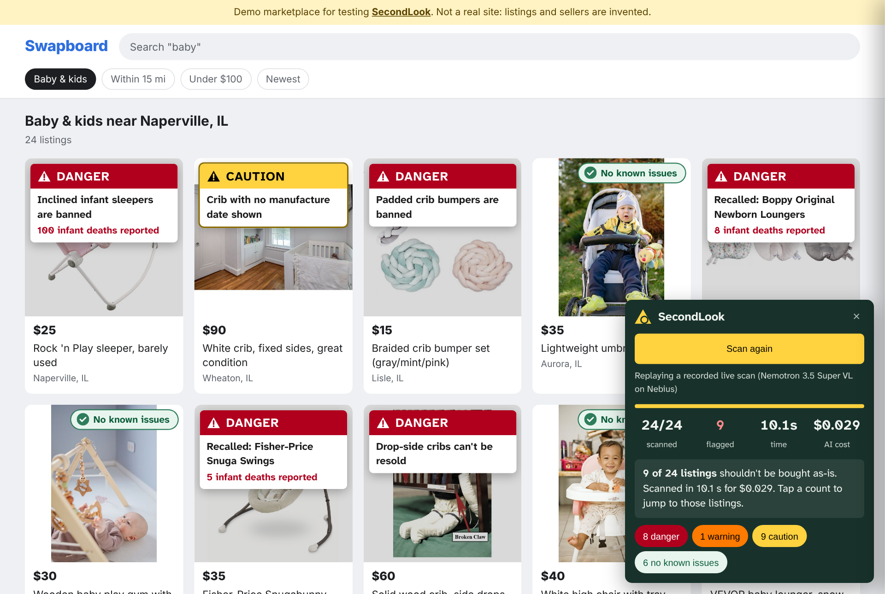

# SecondLook

**Scrolling a marketplace for used baby gear? Press one button. SecondLook checks every listing on the page in parallel and stamps the banned, recalled and expired ones before you buy. Then it tells you what to ask the seller.**

Built for the Nebius × NVIDIA Global AI Hackathon (Best Apps and Agents track) with NVIDIA Nemotron models on **Nebius Token Factory** and **Tavily**.

- **Live demo:** [secondlook-xllm.onrender.com/market](https://secondlook-xllm.onrender.com/market) (marketplace scan; press **Scan this page**) and [single-listing check](https://secondlook-xllm.onrender.com/). Free hosting: the first visit after a quiet spell can take about a minute to wake up.
- Demo video: _link added after recording_



## The problem nobody checks

Parents buy a lot of baby gear second-hand, and nobody thinks to check a $20 sleeper. But products banned or recalled for infant deaths are still everywhere on marketplaces:

- In Sept 2026, Consumer Reports found **50 in-bed infant sleepers among the first 65 Facebook Marketplace listings** it checked; Facebook, Craigslist and Mercari removed none of the items it reported.
- **Inclined sleepers and padded crib bumpers are banned outright** (Safe Sleep for Babies Act; 16 CFR 1310 and 1309), and **drop-side cribs can't be resold** (16 CFR 1219/1220). Selling recalled products is unlawful for *any* seller, including individuals (CPSA §19).
- The Fisher-Price Rock 'n Play alone is linked to ~100 deaths; the Boppy Newborn Lounger to 10.
- **There's no federal car seat expiration rule**; manufacturers set lifespans (6–12 years), printed on a sticker most buyers never look for.

Recall apps exist, but they all check things you *already own* by barcode. **None checks a listing, at the moment you're about to buy, for banned product types, recalls and car seat expiration together.** (10 competitors reviewed; see [`docs/safety_rules_research.md`](docs/safety_rules_research.md).)

## How it works

**Models read, code decides.** No model ever picks the verdict.

```
Marketplace page (demo site or browser extension) → listing cards: photo + title + text
  │   8 at a time, streamed back to the page as each finishes (server-sent events)
  ├─ Nemotron 3.5 Super VL ── product type (24 categories), brand, model numbers, printed dates, colors/prints,
  │                           visible safety features (incline, drop-side rails, padded bumper, Snuga headrest, Bumbo belt…)
  │   + listing text read by rules ("great for naps", "side drops down", label dates in any format)
  ▼
Rules engine (no AI) ─────── federal bans, date-gated standards, car seat lifespan by brand, safety-parts checklist
Local recall index ───────── 813 CPSC infant-product recalls + 69 NHTSA car seat campaigns (with manufacture-date ranges)
  ▼
Nemotron 3 Ultra ─────────── reads each candidate recall notice and answers fixed questions:
                              same brand? same kind of product? does the recall limit models, dates, prints or a product line?
                              does the listing match, differ, or not show it?  → code turns the answers into a verdict
                              (reasoning off during the page scan; reasoning on when you open a listing)
Tavily Search + Nemotron Nano ─ anything newer than our recall snapshot for this product?
Nemotron 3 Ultra ─────────── plain-language summary + a polite message to the seller (from the findings only)
```

The verdict uses the signal words of the ANSI Z535 warning-label standard:

| Stamp | Meaning |
|---|---|
| **DANGER** | Banned from sale, or recalled for deaths or with a stop-use or refund remedy |
| **WARNING** | Safety agencies advise against it (an expired car seat, an infant lounger used for sleep), or a recall with a repair remedy |
| **CAUTION** | Ask the seller first: a possible recall whose model number or date isn't shown, a crib with no manufacture date |
| **No known issues** | No ban, standard problem or recall found |

Every reason cites its rule (16 CFR part, statute, recall number), and recall cards show the official CPSC photo, hazard and remedy. A recall fix visible in the photos is recognized (Snuga swing headrest removed, Bumbo belt installed). When a recall covers only one model number and the listing doesn't show it, SecondLook says CAUTION and names the label to ask for, rather than guessing.

### Browser extension

[`extension/`](extension/) runs the same scan on any listing page: site adapters for common marketplaces plus a generic finder (an image next to a price). Install with Load unpacked; see [`extension/README.md`](extension/README.md). It only runs when you press **Scan this page**.

## How NVIDIA Nemotron and Nebius Token Factory are used

| Job | Model | Why this tier |
|---|---|---|
| Recognize the product and read labels from amateur photos and screenshots | **Nemotron 3.5 Super VL**, strict JSON schema | Vision plus structured output; many recalled items are unbranded marketplace products, so recognition beats barcode lookup |
| Read candidate recall notices during the page scan | **Nemotron 3 Ultra**, reasoning off | The CPSC model field is usually empty; model numbers, prints and product lines live in prose. Fast enough for a 24-listing page |
| Re-read the notices when you open a listing; write the summary and seller message | **Nemotron 3 Ultra**, reasoning on | Careful, grounded wording |
| Recall-news freshness check | **Nemotron 3 Nano** (+ Tavily Search) | Fast, cheap yes/no |
| Read a public listing link | **Tavily Extract** | Listing text and image URLs |

Token Factory features used: OpenAI-compatible chat completions with image input, strict JSON-schema output, the per-request reasoning switch (`chat_template_kwargs.enable_thinking`), usage accounting (cost per scan shown live), and a daily spend cap. Rate limits and transient errors are retried; a reply without valid JSON falls back cleanly. Model IDs are verified live via `GET /v1/models` (`scripts/smoke_test.py`).

The public demo replays a recorded live scan ([`scripts/build_market_cache.py`](scripts/build_market_cache.py), log in [`eval/market_scan_log.txt`](eval/market_scan_log.txt)) with its real per-listing timings and costs, so visitors don't spend credits. Add `?live` to the marketplace URL to scan live.

## Design

Colors, signal words and layout follow published warning research rather than taste; see [`docs/design/design_evidence.md`](docs/design/design_evidence.md). Signal words and colors follow ANSI Z535; DANGER is used only for banned or deadly-recall items to avoid warning fatigue; the palette was checked under simulated color-vision deficiency ([`docs/design/cvd_market.png`](docs/design/cvd_market.png)); the pages pass an axe-core accessibility audit (`tests/ui_audit.py`); the summary comes first and the detail on demand.

## Measured results

**Live marketplace scan** (24 listings built from real CPSC recall photos and free stock photos, each labeled with the verdict a careful reader would give; full log in [`eval/market_scan_log.txt`](eval/market_scan_log.txt)):

| Listing should be | Stamped DANGER | Stamped WARNING | Stamped CAUTION | Stamped No known issues |
|---|---|---|---|---|
| DANGER (12 banned or recalled) | 8 | | 4 | **0** |
| WARNING (1 expired car seat) | | 1 | | |
| CAUTION (5 ask-first) | | | 5 | |
| No known issues (6) | | | | 6 |

20 of 24 exactly right, **no banned or recalled listing marked safe, and no false alarm on a safe listing.** The 4 that got CAUTION instead of DANGER are recalls whose notice names a model number the listing doesn't show; SecondLook tells the buyer which number to look for. All 24 checked in **about 10 seconds** (8 in parallel) for **$0.029** in model costs. The 6 single-listing demo screenshots: 6 of 6 as expected.

**Benchmark** ([`eval/RESULTS.md`](eval/RESULTS.md), generated by `python -m eval.run_eval` against live models):

| Test | Result |
|---|---|
| Recall matching, 40 listings built from real recall records + 40 look-alike decoys | Rules + recall index: 95% caught, 0% false alarms. **+ Nemotron 3 Ultra reading the notices: 98% caught, 0% false alarms.** Ultra alone from memory: 0% caught, 55% false alarms (why SecondLook always checks the official data). |
| Product type from a CPSC recall photo alone, no listing text (54 photos, 14 types) | 57% exact, 74% counting near neighbors (swing vs. inclined sleeper). Super VL sometimes describes the product correctly ("a baby walker") but picks "other"; code reads its description instead (7 photos). Real listings also have a title, which the app reads. |
| The 6 single-listing demo screenshots | 6 of 6 |

## Run it

```bash
pip install -r requirements.txt
export NEBIUS_API_KEY=...   # Nebius Token Factory
export TAVILY_API_KEY=...   # optional: listing links + recall news
uvicorn app.main:app --reload      # http://localhost:8000  (marketplace scan: /market)
```

Marketplace URL options: `?live` scans with live models instead of the recorded scan, `?auto` starts scanning on load, `?plain` hides the built-in button so the browser extension does the scanning.

Without keys, the demo listings use cached model outputs and new checks fall back to reading the listing text with rules.

```bash
python -m pytest -q                       # rules engine tests
python -m scripts.smoke_test              # model IDs, reasoning toggle, vision JSON, Tavily
python -m eval.run_eval                   # benchmark
python -m scripts.build_demo_cache        # refresh cached outputs for the demo listings
python -m scripts.build_market_cache      # record a live scan of the demo marketplace (prints accuracy, time, cost)
python -m data.build_index --cpsc all.json --nhtsa FLAT_RCL_POST_2010.txt   # rebuild the recall index
python -m data.make_listings              # rebuild demo listing screenshots
```

## Data and credits

- Recalls: U.S. CPSC Recalls API (public, no key) and NHTSA recalls flat file. Snapshot Oct 25, 2026.
- Recall photos are from U.S. CPSC recall notices, which CPSC states may be copied and distributed without permission; shown with credit. CPSC does not endorse SecondLook.
- Demo listings and the "Swapboard" marketplace are mock-ups built from those photos and free Pexels stock photos; sellers are invented and the car seat label is synthetic.

## Limits

SecondLook can't inspect the item, can't see wear, crash damage or hidden defects, and isn't legal advice. Whether federal crib and car seat resale rules apply to one-off private sellers is unsettled; we cite the rules and CPSC's own guidance. CPSC "unilateral warnings" (when a seller refuses to recall) aren't in the recall API and are only partly covered.

## License

Apache 2.0
